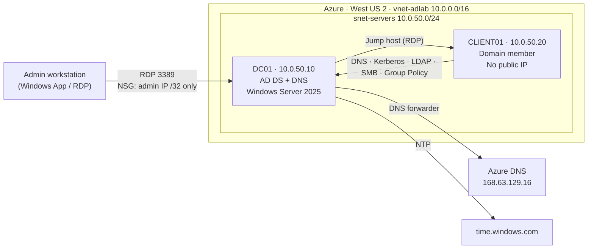

# Active Directory Enterprise Lab on Microsoft Azure

A Windows Server 2025 Active Directory domain built from scratch in Azure: a domain controller and a domain-joined member server on an isolated virtual network. Users, groups and OUs are scripted in PowerShell, access is controlled with Group Policy, and every control was verified with test accounts, `gpresult` and the Security event log.

> **Status:** AD build and Group Policy complete (Nov 2026). Next phases: Splunk log monitoring, then an AD Certificate Services (PKI) hardening lab on the same domain.

---

## Architecture



| Component | Configuration |
|---|---|
| Domain | `corp.khlab.internal` (NetBIOS `KHLAB`). `.internal` is reserved for private use, unlike `.local` |
| DC01 | Windows Server 2025 Datacenter (Azure Edition), Standard_B2als_v2 (2 vCPU / 4 GB), AD DS + DNS, static private IP `10.0.50.10` |
| CLIENT01 | Windows Server 2025 domain member acting as the workstation (Windows 11 in Azure needs separate licensing; Group Policy and authentication behave the same), static IP `10.0.50.20`, **no public IP** |
| Network | VNet DNS set to custom `10.0.50.10`; DC forwards external lookups to Azure DNS; RDP allowed only from the admin's IP (`/32`); CLIENT01 reached only through DC01 |
| Time | DC01 (PDC emulator) syncs from `time.windows.com`, which matters because Kerberos rejects clocks more than 5 minutes off |
| Cost controls | Budget alert, auto-shutdown at 11 PM, VMs deallocated between sessions, Standard SSD disks |

> The resource group's metadata sits in East US (created before the region restriction was found, see troubleshooting #1); every resource inside it runs in **West US 2**.


---

## Directory design

```
corp.khlab.internal
├── Domain Controllers              ← SEC - Advanced Audit Policy
└── KHLAB
    ├── Computers                   (OU, not the default CN=Computers container)
    │   ├── Workstations            ← WKS - Remote Desktop Users, SEC - Advanced Audit Policy
    │   └── Servers
    ├── Users                       ← USR - Department Drive Maps
    │   ├── Finance                 ← USR - Restrict Control Panel
    │   ├── HR                      ← USR - Restrict Control Panel
    │   ├── IT                      (no restrictions; IT is the exception)
    │   ├── Operations              ← USR - Restrict Control Panel
    │   └── Sales                   ← USR - Restrict Control Panel, USR - Block Removable Storage
    ├── Groups                      GG_IT, GG_HR, GG_Finance, GG_Sales, GG_Operations
    ├── Service Accounts
    └── Disabled
```

- **55 users** (11 per department) created by [`scripts/New-LabUsers.ps1`](scripts/New-LabUsers.ps1), each placed in their department OU and global security group.
- Permissions go to **groups, never individual users** (`GG_` = Global Group), so moving someone between departments is one membership change.
- New accounts **must change their password at first logon**, so the admin never knows it.


<!-- TODO: images/21-aduc-ou-tree.png (ADUC showing the OU tree and Finance users) -->
<!-- TODO: images/21b-gg-finance-members.png -->

---

## Group Policy

| GPO | Linked to | What it does |
|---|---|---|
| Default Domain Policy | Domain | Password: minimum 14 characters, complexity (3 of 4 character types), 24-password history, 42-day max age. Lockout: 5 attempts, 10-minute duration and reset window |
| USR - Department Drive Maps | KHLAB\Users | Maps `S:` to the user's department share. **One GPO, five drive maps**, each scoped with item-level targeting by security group |
| USR - Restrict Control Panel | Finance, HR, Sales, Operations | Prohibits Control Panel and PC Settings for every department except IT |
| USR - Block Removable Storage | Sales | Denies all removable storage classes |
| WKS - Remote Desktop Users | Workstations | Adds `GG_Finance` and `GG_IT` to the local built-in Remote Desktop Users group |
| SEC - Advanced Audit Policy | Domain Controllers, Workstations | Credential validation, logon/logoff, account lockout, user and group management, process creation **with command lines**. This is the data source for the Splunk phase |

**Department file shares** (`\\DC01\<Dept>`): inheritance removed; NTFS gives the department group Modify and Domain Admins/SYSTEM Full. Share permissions are also scoped to the department group (defense in depth: the most restrictive of share and NTFS wins).


<!-- TODO: images/25-shares-ntfs.png (Get-SmbShare + icacls) -->
<!-- TODO: images/29-audit-policy.png (audit subcategory settings) -->

---

## Verification

Each control was tested as a real user rather than assumed from configuration.

| Test | Expected | Result |
|---|---|---|
| CLIENT01 DNS points at the DC and resolves the domain | DNS server `10.0.50.10`; domain resolves to `10.0.50.10` | ✅ |
| Finance user receives the correct policies | Drive Maps + Restrict Control Panel applied | ✅ |
| Finance user share access | `S:` → `\\DC01\Finance` works; `\\DC01\IT` **Access is denied** | ✅ |
| Finance user Control Panel | Blocked with "restrictions in effect" | ✅ |
| IT user share access | `S:` → `\\DC01\IT`; `\\DC01\Finance` **Access is denied** | ✅ |
| IT user Control Panel | Opens (IT is exempt) | ✅ |
| Account lockout | Locked after 5 bad passwords (`LockedOut: True`, `BadLogonCount: 5`), then unlocked | ✅ |
| Removable storage (Sales) | Policy applies | ⚠️ Configured and applied; **not physically testable** (no USB on an Azure VM) |
| Final GPO inventory | Only the 7 intended GPOs | ✅ |


<!-- TODO: images/31i-event-4740.png (Security event 4740: account locked out, caller CLIENT01) -->

---

## Troubleshooting log

Most of what this lab taught came from things that broke. Each entry lists the symptom, how it was diagnosed, and the fix.

| # | Symptom | Diagnosis | Fix |
|---|---|---|---|
| 1 | VNet creation in East US failed with a vague policy error and **no deployment record** | No record meant the request was rejected at validation. Isolated it to the student subscription's allowed-region policy by retrying identical settings in other regions | Deployed everything in **West US 2** |
| 2 | "No available sizes" when creating the VM | The only selectable size had 1 GB RAM, too little for a DC with the desktop experience | Used **Standard_B2als_v2** (4 GB) |
| 3 | RDP to DC01 rejected the (correct) password | Read `adminUsername` from the VM's JSON view and found a one-letter typo in the configured username. The same check later found the client's local admin name differed | Logged in with the username actually configured |
| 4 | RDP timed out (error `0x704`) after changing networks | `nc -vz <ip> 3389` timed out, so traffic was blocked before reaching Windows. `curl ifconfig.me` returned IPv6; the NSG needed the **IPv4** address | Updated the NSG source to the current IPv4 `/32` (`curl -4 ifconfig.me`) |
| 5 | `Install-ADDSForest` failed: "restart required" | Automatic patching had left a pending reboot | Restarted, then promoted |
| 6 | Promotion failed: DSRM password rejected | DSRM password didn't meet complexity rules | Re-ran with a compliant password |
| 7 | `dcdiag` failed DFSREvent and SystemLog; warnings for DNS timeouts and no time source | DFSR/SystemLog failures are expected on a brand-new DC. The DC couldn't resolve external names and wasn't syncing time | Added DNS forwarder `168.63.129.16`; configured `w32tm` to sync from `time.windows.com` |
| 8 | User script reported "11 users" per department, but **nobody could log in** | The initial password failed domain complexity. `New-ADUser` still created each object, leaving it **disabled with no password**. The errors were non-terminating, so the summary looked successful | Bulk-reset passwords and enabled all 55 accounts; then **hardened the script**: a pre-flight password check, `$ErrorActionPreference = "Stop"`, and a summary that counts *enabled* accounts |
| 9 | Only Default Domain Policy applied to CLIENT01 | `gpresult /scope computer` showed no workstation GPOs. `Get-ADComputer` showed CLIENT01 still in the default `CN=Computers` **container**, where GPOs can't be linked. The RDP GPO was also linked one level too high | Moved CLIENT01 to `KHLAB\Computers\Workstations`; relinked the GPO at the lowest OU that covers it (least privilege) |
| 10 | RDP GPO applied, but Remote Desktop Users **stayed empty** | The GPO report showed the group name was typed as "remote desktop", so Group Policy **created a new local group** with that name instead of updating the built-in one | Selected *Remote Desktop Users (built-in)* from the dropdown; deleted the stray local group |
| 11 | Stray GPOs (`USR`, `WKS`, `ServiceACCPO`) in the domain | Leftovers from naming mix-ups. `ServiceACCPO` held password settings linked to an OU, which **do not apply to domain accounts** (password policy only applies at the domain level) | Unlinked and deleted them. Per-group password rules need a Fine-Grained Password Policy |
| 12 | Test users couldn't RDP with "must change password at next logon" set | RDP's Network Level Authentication can't process a forced password change | Cleared the flag on the two test accounts only; all other accounts keep it |
| 13 | Finance test user: "logon attempt failed" over RDP | `runas` on the DC returned **error 1385** (logon type not granted), which proved the password was valid, since Windows checks credentials first. The CLIENT01 Security log showed **4625, sub-status `0xC0000064`** (unknown user) | Logging in with the UPN (`user@corp.khlab.internal`) succeeded. The `DOMAIN\user` failure wasn't fully isolated |
| 14 | Lockout test didn't lock the account; no 4740 event | Errors had been hidden with `2>$null`. Visible output showed every attempt reaching the DC (error 1326), yet `BadLogonCount` stopped at 3 when the **same** wrong password was repeated | With **different** wrong passwords the account locked at 5 (error 1909). *Observed behavior:* repeated identical bad passwords weren't counted as new attempts |

**#9: GPOs linked at the parent Computers OU while CLIENT01 sat outside it; relinked to Workstations**


**#10: The typed group name created a new local group; fixed by selecting the built-in group**


<!-- TODO: images/28c-rdp-group-applied.png (net localgroup "Remote Desktop Users" showing GG_Finance, GG_IT) -->

**#11: Stray GPO cleanup**


**#14: Lockout test troubleshooting**


---

## What I'd do differently in production

- **Two or more domain controllers**, plus a separate file server. Shares on a DC were a lab shortcut.
- Put the **NTDS database on a data disk with host caching set to None**. `dcdiag` flagged the write-cache risk of the OS disk.
- **No public RDP.** Use Azure Bastion or a VPN instead of an IP-restricted NSG rule.
- Keep private subnets with a **NAT gateway** for outbound access.
- Run `redircmp` so newly joined computers land in a real OU automatically (the cause of issue #9).
- Set lockout duration to **15+ minutes** (CIS benchmark), and use a **Fine-Grained Password Policy** for service accounts.
- Use Windows 10/11 for client endpoints.

## Repository layout

```
ad-lab/
├── README.md
├── scripts/
│   └── New-LabUsers.ps1     # OU tree, department groups, 55 users (with pre-flight password check)
└── images/                  # Screenshots; public IPs, subscription IDs and SIDs redacted
```

## Skills demonstrated

Active Directory Domain Services · DNS · Group Policy (security settings, preferences, item-level targeting, audit policy) · NTFS and share permissions · PowerShell automation · Windows Security event log analysis (4625, 4740, error codes 1326/1385/1909) · Azure VMs, VNets, NSGs and cost controls · Systematic troubleshooting
